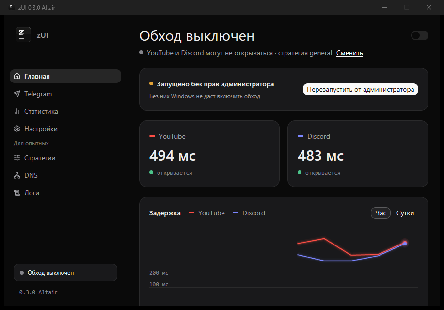
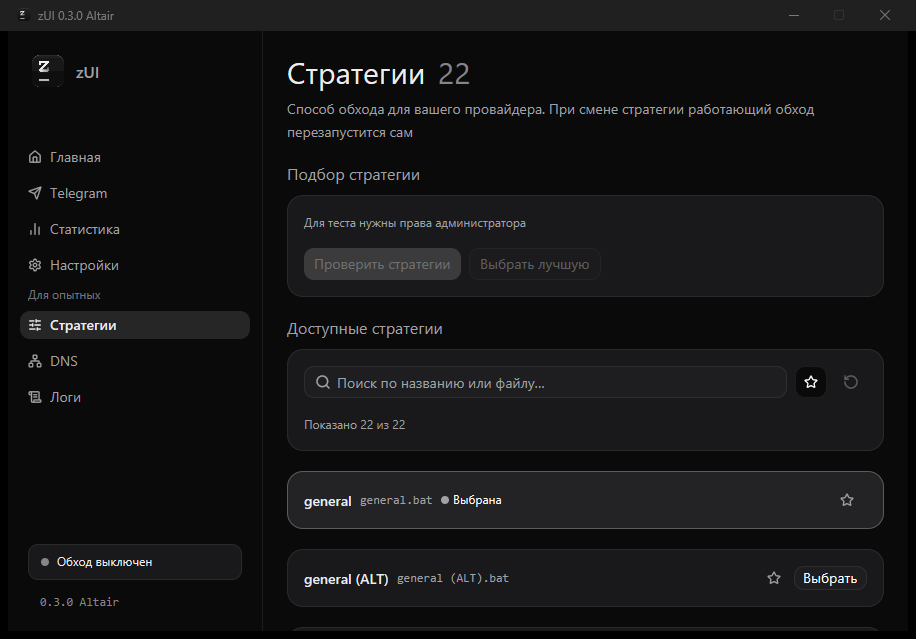
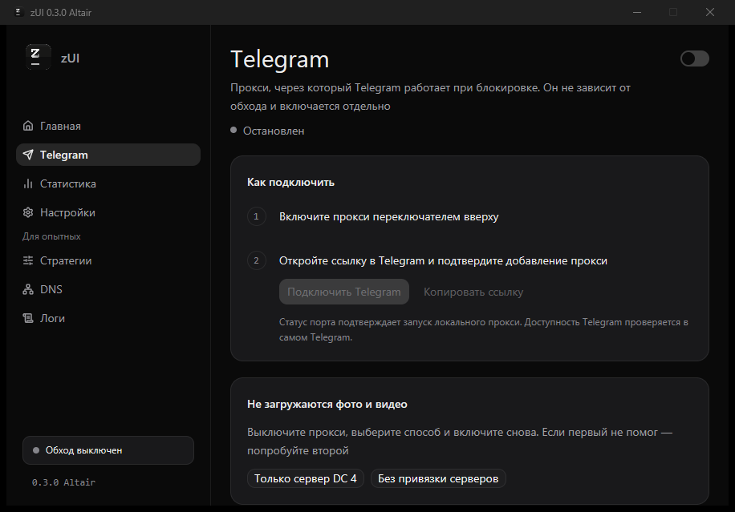
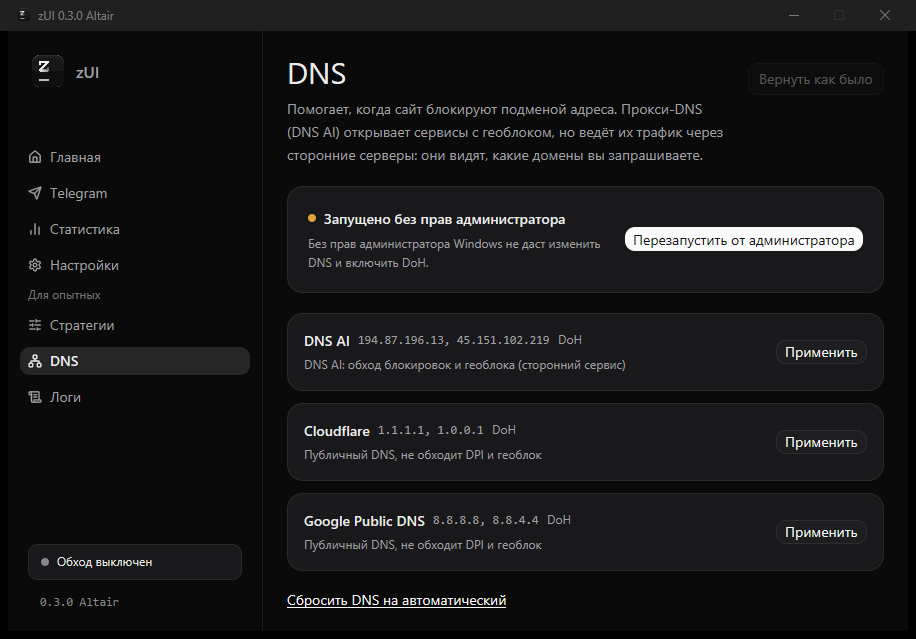
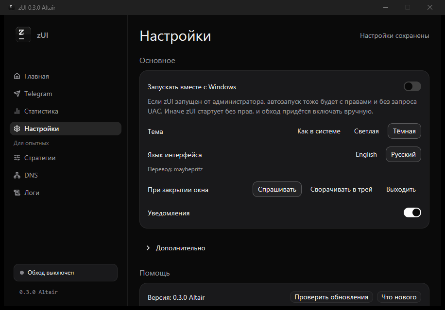
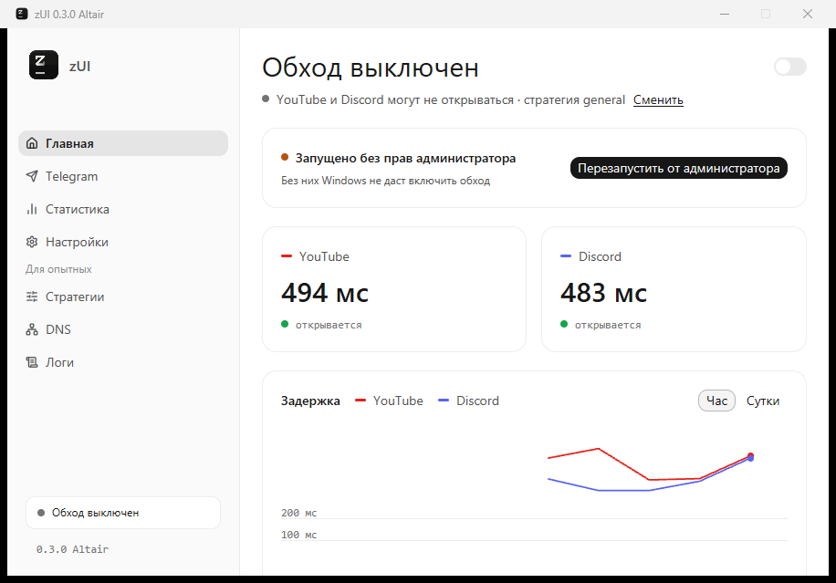
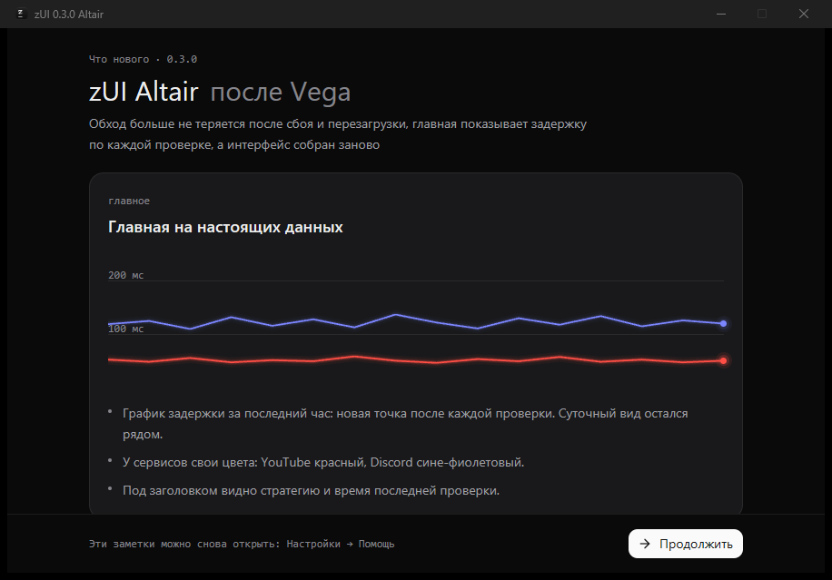

<p align="center">
  
</p>

<h1 align="center">zUI</h1>

<p align="center">
  <b>Обход блокировок YouTube и Discord одной кнопкой</b><br>
  Графическое приложение для <a href="https://github.com/Flowseal/zapret-discord-youtube">zapret-discord-youtube</a>: само подбирает стратегию, следит, что сервисы открываются, и не теряет обход после сбоя или перезагрузки.
</p>

<p align="center">
  <a href="https://github.com/maybepritz/zUI/releases/latest"></a>
  
  <a href="LICENSE"></a>
</p>

<p align="center">
  <a href="https://github.com/maybepritz/zUI/releases/latest"><b>Скачать</b></a> ·
  <a href="CHANGELOG.md">Что нового</a> ·
  <a href="https://github.com/maybepritz/zUI/issues/new">Сообщить о проблеме</a> ·
  <a href="docs/localization.md">Добавить перевод</a>
</p>

<p align="center">
  
</p>

## Зачем

Zapret обходит блокировки, но требует знать, что такое стратегия, запускать `.bat`-файлы от администратора и разбираться, почему опять не грузит видео. zUI берёт это на себя:

- **Подбирает сам.** Кнопка «Подобрать» перебирает стратегии, проверяет настоящий видеоузел YouTube у вашего провайдера и включает первую, с которой открывается всё.
- **Показывает, что происходит.** Главная раз в минуту проверяет сервисы и рисует задержку: видно, работает ли обход и когда что-то сломалось.
- **Не теряет обход.** Запускается вместе с Windows сразу с правами, по желанию поднимает winws после сбоя, а при закрытии или падении zUI не оставляет процессы без присмотра.

## Скриншоты

<table>
  <tr>
    <td width="50%"></td>
    <td width="50%"></td>
  </tr>
  <tr>
    <td><b>Стратегии</b> – поиск, избранное и результаты проверки у каждой</td>
    <td><b>Telegram</b> – прокси Flowseal: включить и открыть ссылку</td>
  </tr>
  <tr>
    <td></td>
    <td></td>
  </tr>
  <tr>
    <td><b>DNS</b> – пресеты с DoH и возврат прежних настроек</td>
    <td><b>Настройки</b> – главное в пяти строках, остальное в «Дополнительно»</td>
  </tr>
  <tr>
    <td></td>
    <td></td>
  </tr>
  <tr>
    <td><b>Светлая тема</b> – или как в Windows</td>
    <td><b>Что нового</b> – показывается после обновления</td>
  </tr>
</table>

## Что нового в 0.3.0 Altair

- **Главная на настоящих данных** – график задержки за последний час по каждой проверке, суточный вид рядом, у сервисов свои цвета.
- **Обход не теряется** – автозапуск с правами без запроса UAC, а при сбое zUI обход и Telegram-прокси останавливаются вместе с ним.
- **Проще настройки и Telegram** – пять строк в настройках, Telegram подключается в два шага.
- **Аккуратное удаление** – zUI возвращает DNS как было и убирает автозапуск.
- **Новый вид** – графитовая палитра, крупные заголовки, заголовок окна в цвет темы.

Полный список – в [CHANGELOG](CHANGELOG.md).

## Возможности

| Раздел | Что умеет |
| --- | --- |
| **Главная** | Переключатель обхода, задержка YouTube и Discord сейчас, график за час и за сутки, отметки сбоев |
| **Подбор** | Перебор стратегий с избранных, проверка видеоузла YouTube, автоматическое включение лучшей |
| **Стратегии** | Ручной выбор, поиск, избранное, тест всех стратегий с результатом у каждой |
| **DNS** | Публичные DNS и прокси-DNS с шифрованием DoH, возврат прежних настроек, сброс на автоматический |
| **Telegram** | Установка и запуск [TG WS Proxy](https://github.com/Flowseal/tg-ws-proxy), подключение по ссылке |
| **Автоматизация** | Перезапуск winws после сбоя, подбор другой стратегии при потере доступа, перепроверка раз в сутки |
| **Надёжность** | Автозапуск с правами, один экземпляр, остановка процессов при сбое zUI, восстановление повреждённых настроек |
| **Обновления** | zUI и Zapret обновляются с GitHub с проверкой SHA-256 |
| **Интерфейс** | Светлая, тёмная и системная темы, русский и английский, переводы без пересборки |

Автоматические проверки и перепроверка выключены по умолчанию. Тест стратегий ненадолго останавливает обход, а потом возвращает всё как было.

## Установка

Нужна **Windows 10 или 11, x64**. Для обхода и изменения DNS zUI нужны права администратора – без них приложение работает, но предложит перезапуститься.

1. Скачайте архив `zUI-x86_64-pc-windows-msvc.zip` со страницы [выпусков](https://github.com/maybepritz/zUI/releases/latest).
2. Распакуйте его в постоянную папку, доступную для записи. Установщик можно собрать сами – см. [installer/README.md](installer/README.md).
3. Откройте zUI и пройдите мастер: он установит Zapret и сам подберёт стратегию.

<details>
<summary><b>Закрытие окна и трей</b></summary>

<br>

В **Настройки → При закрытии окна** выбирается одно из трёх:

- **Спрашивать** – каждый раз показывать вопрос «Скрыть в трей / Выйти».
- **Сворачивать в трей** – zUI и обход продолжают работать, значок остаётся у часов.
- **Выходить** – сервисы останавливаются, приложение закрывается.

Из трея можно снова открыть окно или полностью выйти. Повторный запуск zUI открывает уже работающее окно.

</details>

<details>
<summary><b>Где лежат данные и как перенести zUI</b></summary>

<br>

Папка `runtime` создаётся рядом с `zUI.exe`:

```text
zUI.exe
runtime/
  settings.json       настройки и избранное
  statistics.json     статистика работы
  health.json         история проверок за сутки
  dns_state.json      состояние DNS и данные для возврата
  logs/zui.log        журнал событий
  locales/            пользовательские переводы
  zapret/             установленный Zapret
  tg-ws-proxy/        Telegram-прокси и его настройки
```

Чтобы перенести zUI, выйдите из приложения и скопируйте его вместе с `runtime`. Если меняли DNS через zUI, сначала верните прежние настройки на вкладке DNS.

Папку открывает **Настройки → Помощь → Открыть папку данных**. Другой путь задаётся аргументом `--runtime ПУТЬ` или переменной `ZAPRET_UI_RUNTIME`.

</details>

## Антивирус и проверка подлинности

**Почему ругается антивирус.** Обход делает `winws.exe` из Zapret: он перехватывает сетевые пакеты через драйвер WinDivert. Так же работают и вредоносные программы, поэтому Защитник Windows и другие антивирусы часто помечают `winws.exe` и `WinDivert64.sys` как `HackTool` или `RiskWare`. Это файлы [Zapret](https://github.com/bol-van/zapret) и [сборки Flowseal](https://github.com/Flowseal/zapret-discord-youtube), а не zUI: zUI скачивает их с GitHub и проверяет SHA-256.

**Если файл ушёл в карантин**, обход не включится, а zUI предложит переустановить Zapret. Восстановите файл в журнале защиты и добавьте в исключения только папку `runtime\zapret` – не весь диск и не папку загрузок.

**«Windows защитила ваш компьютер».** `zUI.exe` пока не подписан сертификатом, поэтому SmartScreen предупреждает о неизвестном издателе. Нажмите **Подробнее → Выполнить в любом случае** – но только для файла, скачанного со страницы [выпусков](https://github.com/maybepritz/zUI/releases).

**Как убедиться, что файл настоящий.** Каждый выпуск собирает GitHub Actions из открытого кода этого репозитория, вручную ничего не собирается. В описании выпуска есть SHA-256 каждого файла – сравните его со своим:

```powershell
Get-FileHash .\zUI-x86_64-pc-windows-msvc.zip
```

GitHub также подписывает подтверждение сборки: из какого коммита и какой сборкой получен файл. Проверить его можно с помощью [GitHub CLI](https://cli.github.com):

```powershell
gh attestation verify .\zUI.exe --repo maybepritz/zUI
```

Подтверждения есть у выпусков начиная с 0.3.1. Любой файл можно дополнительно проверить на [VirusTotal](https://www.virustotal.com) – только сам `zUI.exe`, без папки `runtime`, иначе в отчёт попадут предупреждения о Zapret.

## Сообщить о проблеме

Откройте **Настройки → Помощь → Сообщить о проблеме**, сохраните или скопируйте отчёт и приложите его к [issue](https://github.com/maybepritz/zUI/issues/new). Отчёт содержит версию, результаты проверок и последние строки журнала, секреты прокси в него не попадают – но перед публикацией всё равно его просмотрите.

## Сборка из исходников

Нужны Rust stable с edition 2024, MSVC Build Tools и Windows SDK.

```powershell
git clone https://github.com/maybepritz/zUI.git
cd zUI
cargo run -p zUI --bin zUI
```

Версия для распространения и проверки проекта:

```powershell
cargo build --release --locked --target x86_64-pc-windows-msvc -p zUI --bin zUI
cargo clippy --workspace --all-targets --locked -- -D warnings
cargo test --workspace --locked
cargo run -p z-i18n --bin check-locales --locked
```

| Crate | Что внутри |
| --- | --- |
| `crates/app` | Интерфейс на GPUI, состояние, обработчики и контроллеры |
| `crates/z-core` | Процессы, сеть, DNS, стратегии, установка и восстановление |
| `crates/z-i18n` | Каталоги Fluent, запасной язык и проверка переводов |

Подробнее: [архитектура](docs/architecture.md) · [выпуск релиза](docs/releases.md) · [переводы](docs/localization.md) · [статистика](docs/statistics.md) · [экран запуска](docs/startup.md)

## Благодарности

- [bol-van/zapret](https://github.com/bol-van/zapret) – Zapret и winws.
- [Flowseal/zapret-discord-youtube](https://github.com/Flowseal/zapret-discord-youtube) – сборка и стратегии для Windows.
- [Flowseal/tg-ws-proxy](https://github.com/Flowseal/tg-ws-proxy) – Telegram WS Proxy.
- [Zed/GPUI](https://gpui.rs) и [Longbridge/GPUI Kit](https://gpui-kit.com) – интерфейс и компоненты.
- [Lucide](https://lucide.dev) – иконки.

zUI развивается независимо от авторов Zapret и Telegram-прокси.

## Лицензия

zUI распространяется под лицензией [MIT](LICENSE). Внешние проекты – под собственными лицензиями.
